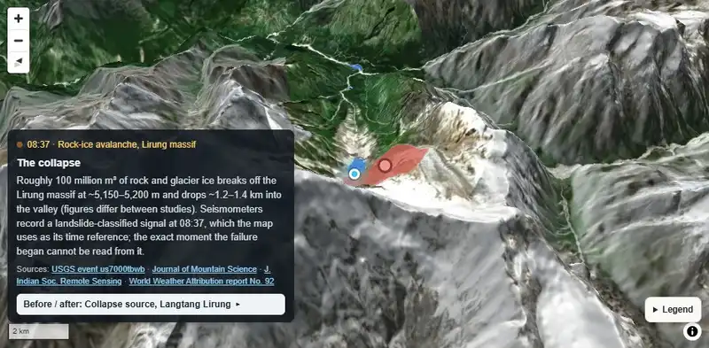
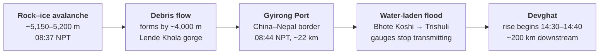
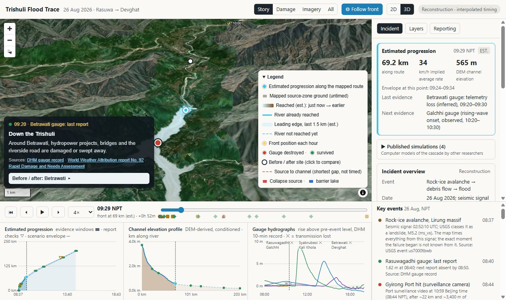
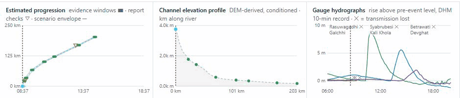
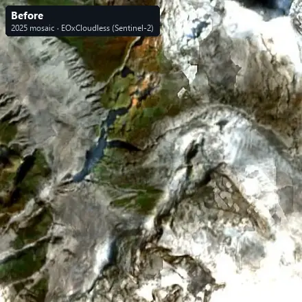
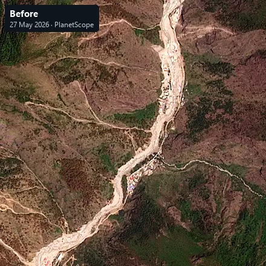
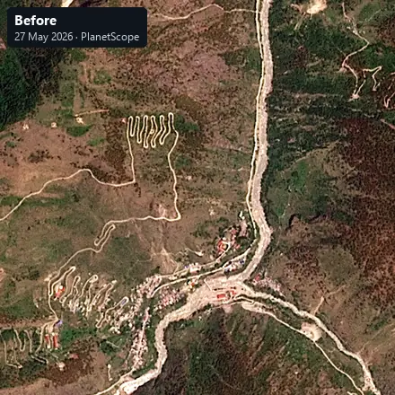
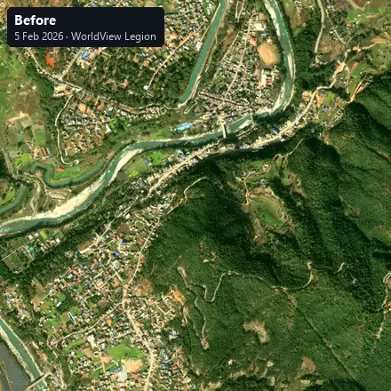
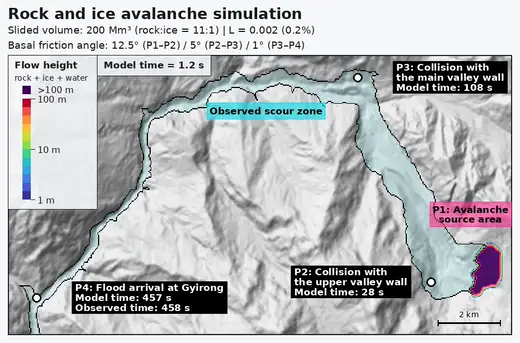
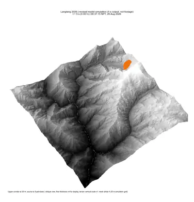

<div align="center">

# Trishuli Flood Trace

**Tracing the 26 August 2026 Lirung rock–ice avalanche and flood, 200 km from a Himalayan ice face to the plains of Nepal**

[](https://trishuli-flood-trace.vercel.app)    [](LICENSE)

<a href="https://trishuli-flood-trace.vercel.app"></a>

<sub>The live map following the flood front at 4× speed (Lirung massif to Malekhu). Basemap: EOxCloudless 2025, CC BY-NC-SA 4.0.</sub>

</div>

## About

A personal passion project: one of a series of self-directed projects where I combine geoscience with coding, data and machine learning. It is not a professional or commissioned study. Every figure comes from already published, citable public data (satellite mapping, agency reports, gauge records and research papers), and where sources disagree the map shows both. It is a reconstruction for understanding, not an official product and not for emergency use.

## The event

At 08:37 Nepal time on 26 August 2026, roughly 100 million m³ of rock and glacier ice broke away from the north side of the Langtang Lirung massif at about 5,150–5,200 m (estimates vary by study: Roy et al., 2026; Li, H. et al., 2026; Clarke et al., 2026). Seismometers recorded the collapse as a magnitude 5.2 landslide signal (USGS, 2026a).



The falling mass turned into a debris flow that scoured the narrow Lende Khola gorge and reached the border crossing at Gyirong Port about seven minutes later, after roughly 22 km and 3,400 m of descent (Guo et al., 2026). Below Syabrubesi it began dropping its largest rock and continued as a more water-laden flood down the Bhote Koshi and Trishuli (Clarke et al., 2026). River gauges stopped transmitting one after another, so the timing upstream is bracketed rather than measured (Acharya and Paudel, 2026). The rising wave reached the Devghat gauge between 14:30 and 14:40. Xu (2026) attributes this first wave to the debris flow itself, possibly with a quick breach of debris dumped across the river. The barrier lakes formed during the cascade, were mapped on 28 August and only began overflowing that afternoon.

## What the map does



- **Follows the front** along a 202 km river route in 3D, revealing the satellite-mapped flood extent (UNITAR-UNOSAT, 2026a) by estimated arrival time.
- **Times every step from evidence:** a seismic origin, a border-port camera, and gauge onsets and telemetry losses. The map interpolates between them and shows an earliest–latest envelope. Reported times that disagree with the gauges are shown as conflicts, not hidden.
- **Separates what was observed from what is estimated**: mapped landslides and building damage (Copernicus EMS, 2026) are never given a time.
- **Steps through 17 key events**, each with a sourced caption, and links them to before/after imagery and published simulations.

### Charts that move with the timeline



Left: estimated progression against the evidence windows. Centre: channel elevation profile from the Copernicus GLO-30 DEM (conditioned for display, not a surveyed bed). Right: river stage at six gauges from the Department of Hydrology and Meteorology (DHM) ten-minute record (Acharya and Paudel, 2026).

## Before and after

Open satellite imagery of four sites along the route, resampled to a common grid so they line up. In the app, each panel also says what the images show and, separately, what the cited sources report happened there.

<table>
<tr>
<td width="50%"><br><b>Collapse source.</b> A bare failure surface where glacier ice was; the detached body covered about 0.72 km² (Guo et al., 2026).<br><sub>EOxCloudless 2025 (10 m mosaic) / Planet Pelican, 29 Sep 2026</sub></td>
<td width="50%"><br><b>Rasuwagadhi–Gyirong border and Timure.</b> Riverside buildings gone and a far wider channel; part of the flow surged about 2 km up the side valley into China (Guo et al., 2026; Clarke et al., 2026).<br><sub>PlanetScope, 27 May 2026 / Planet Pelican, 1 Sep 2026</sub></td>
</tr>
<tr>
<td><br><b>Syabrubesi.</b> Flood deposits over the low ground where the bazaar stood; Copernicus EMS graded 323 building points here as destroyed.<br><sub>PlanetScope, 27 May 2026 / Vantor WorldView Legion, 7 Sep 2026</sub></td>
<td><br><b>Bidur and Trishuli Bazaar.</b> The river and its canal replaced by a broad sheet of grey sediment, about 75 km along the river from the source.<br><sub>Vantor WorldView Legion, 5 Feb 2026 / Vantor WorldView-2, 8 Sep 2026</sub></td>
</tr>
</table>

<sub>Imagery © Planet Labs PBC (Crisis Response Program) and © Vantor (Open Data Program), CC BY-NC 4.0; EOxCloudless 2025 by EOX IT Services GmbH, CC BY-NC-SA 4.0. Cropped, warped and contrast-stretched. Scene IDs are in <a href="web/data/sites.json"><code>web/data/sites.json</code></a>.</sub>

## Published simulations

Other researchers have modelled the cascade, and the app shows their animations with the authors' own caveats. They are **model scenarios, not footage**, and are independent of this map's timeline: neither confirms the other.

<table>
<tr>
<td width="56%"><br><b>The first ten minutes.</b> A rock–ice–water flow model (r.avaflow) from an imposed 200 million m³ release. With frictional melting included it reaches Gyirong at 457 s against the observed 458 s; runs without melting take 593 s or more.<br><sub>Huang, Chen and Wang (2026), Movie S7, CC BY 4.0. Paper in preparation.</sub></td>
<td width="44%"><br><b>The upper gorge, first 24 minutes.</b> A 30 m rock–ice flow model from the source to Syabrubesi; flow thickness exaggerated four times for display.<br><sub>Park (2026), v2.0.0, CC BY 4.0. Preprint, not peer reviewed.</sub></td>
</tr>
</table>

<sub>Shown sped up (2×) and converted to animated WebP for this page; the app plays the original files unmodified. Two further full-corridor animations by Park are in the app's "Published simulations" panel.</sub>

## Observed, reported or estimated

| Layer | Status | Source |
|---|---|---|
| Flood extent, affected buildings, barrier lakes, detachment zone | Observed (satellite interpretation, 26–28 Aug) | UNITAR-UNOSAT (2026a, 2026b) |
| Mapped landslides; building and road damage grading | Observed (photo-interpreted, four mapping areas) | Copernicus EMS (2026) |
| River stage at seven gauges | Observed (DHM ten-minute record) | Acharya and Paudel (2026); NDRRMA (2026c) |
| Origin time | Observed (seismic) | USGS (2026a) |
| Border-port arrival | Observed (camera, 10:59 Beijing = 08:44 NPT) | Guo et al. (2026) |
| Arrival time along the rest of the route | **Estimated** between evidence windows | this project, see [METHODS.md](METHODS.md) |
| Channel elevation profile | **Derived** from the GLO-30 DEM | this project |
| Source size, volume, precursors, weather | Reported, with ranges where studies differ | see references |

The app shows aggregate figures only and holds no names or personal details of victims.

## Built with

- **Web:** MapLibre GL JS 6.17 with 3D terrain, sky and fog; plain JavaScript and SVG charts; no build step; hosted on Vercel.
- **Data pipeline:** Python (rasterio, GeoPandas, Shapely, NumPy, SciPy): OSM river routing with Dijkstra, evidence-window timing, DEM profiling, Sentinel-2 median composites and before/after scene alignment.
- **Terrain and basemap:** Copernicus GLO-30 via Mapterhorn; EOxCloudless 2025.

Method, limits and every timing decision: [METHODS.md](METHODS.md) · Evidence anchors: [anchors.csv](anchors.csv) · Full source list with versions and licences: [sources.csv](sources.csv) · Terms per data file: [DATA-LICENCES.md](DATA-LICENCES.md)

## References

**Research papers, preprints and reports**

- Acharya, S. and Paudel, A. (2026) *The Bhote Koshi-Trishuli flash flood of 26 August 2026, Rasuwa, Nepal: data and analysis code*. Version 3.0.0. Zenodo. doi:10.5281/zenodo.22679444.
- Clarke, B., Zachariah, M., Davies, B., Hock, R., Immerzeel, W. et al. (2026) *Rapid warming in the Himalaya exacerbates geohazard cascades beyond adaptation limits*. World Weather Attribution scientific report No. 92 (corrected 28 September 2026). doi:10.25560/136420.
- Guo, L., Xu, J., Wang, Y. et al. (2026) 'Progressive entrainment transformed a high-elevation ice–rock avalanche in Nepal into the 26 August debris flow in Gyirong, Xizang' [in Chinese], *Chinese Science Bulletin*, published online 1 September 2026. doi:10.1360/CSB-2026-1255.
- Huang, S., Chen, C.-M. and Wang, B. (2026) *Datasets and analysis scripts for 'The first minutes of the 2026 Nepal rock-ice avalanche and flash flood'*. Zenodo. doi:10.5281/zenodo.22884627.
- Li, H., Li, P., Hu, K., Liu, J., Liu, S., Kang, S., Su, P. and You, Y. (2026) 'The 26 August 2026 Chhochen Khola ice-rock avalanche–debris flow cascade on the Nepal–China border: dynamics, numerical computation, and causes', *Journal of Mountain Science*, 23(10), pp. 4663–4681. doi:10.1007/s11629-026-1482-y.
- Li, R. (2026) 'When a high-mountain slope failure cascades downstream: physical footprint and evolving exposure of the 2026 Gyirong mixed rock–ice cascade', *arXiv* preprint 2609.04563.
- Park, H. (2026) *Langtang 2026 rock-ice avalanche and flood: revised simulation animations and supporting outputs*. Version 2.0.0. Zenodo. doi:10.5281/zenodo.22566624.
- Roy, P., Majumdar, R., Chauhan, P. et al. (2026) '26 August 2026 rock–ice avalanche in Nepal: rapid assessment of the cascading disaster using satellite data', *Journal of the Indian Society of Remote Sensing*, 54(13), pp. 4901–4909. doi:10.1007/s12524-026-02611-x.
- Xu, D. (2026) 'The 26 August 2026 Langtang Lirung ice–rock avalanche and its transboundary cascade: a multi-source observational reconstruction in the Bhote Koshi basin', *EarthArXiv* preprint, version 2. doi:10.31223/X56793.

**Agency reports, mapping and records**

- CHWRR (2026) *Assessment Report II: Rasuwa-Bhote Koshi Flood Event 2026* (revised 13 September 2026). Kathmandu: Centre for Hydrological Warning and Risk Reduction, Government of Nepal.
- Copernicus EMS (2026) *EMSR927: Flood in Nepal, grading products for AOI01, AOI02, AOI03 and AOI05*. © 2026 European Union. Available at: https://mapping.emergency.copernicus.eu/activations/EMSR927/.
- ICIMOD (2026) *Second major Himalayan flood in seven weeks raises new questions about mountain risk*. Press release, 13 October 2026. Kathmandu: ICIMOD.
- International Charter Space and Major Disasters (2026) *Activation 1052: Flood in Nepal*.
- NDRRMA (2026a) *Rapid Damage and Needs Assessment: Rasuwa-Bhotekoshi Flood 2026*. Kathmandu: National Disaster Risk Reduction and Management Authority.
- NDRRMA (2026b) *Situation Report 19*, 20 September 2026. Kathmandu: NDRRMA.
- NDRRMA (2026c) *BIPAD portal river-station register and stage record, Trishuli at Furke Khola (Malekhu), station 261*. Available at: https://bipadportal.gov.np/.
- UNITAR-UNOSAT (2026a) *Product 4256: flood extent, affected buildings, detachment zone and barrier lakes, Rasuwa, Nepal (FL20260826NPL)*. Available at: https://unosat.org/products/4256.
- UNITAR-UNOSAT (2026b) *Product 4260: satellite-detected barrier lakes*. Available at: https://unosat.org/products/4260.
- USGS (2026a) *M 5.2 landslide, Nepal–China border region (us7000tbwb)*. ANSS Comprehensive Catalog.
- USGS (2026b) *M 4.2 landslide signal (us7000tc90)*. ANSS Comprehensive Catalog.

**Imagery, terrain and media**

- ESA (2026) *Nepal flash flood imaged by satellites*. Sentinel-2 (24 August) and Landsat 9 (26 August) renderings, published 31 August 2026.
- EOX IT Services GmbH (n.d.) *EOxCloudless 2025*. CC BY-NC-SA 4.0. Available at: https://cloudless.eox.at.
- Mapterhorn (n.d.) *Terrain tiles* (Copernicus GLO-30 DEM; © DLR e.V. 2010–2014 and © Airbus Defence and Space GmbH 2014–2018, provided under COPERNICUS by the EU and ESA). Available at: https://mapterhorn.com.
- OpenStreetMap contributors (2026) *Waterways, Bhote Koshi–Trishuli corridor*. ODbL 1.0.
- Planet Labs PBC (2026) *Crisis Response Program: nepal-flash-flood-2026-08-26*. Source Cooperative. CC BY-NC 4.0.
- Vantor (2026) *Open Data Program: Nepal-Flooding-Aug-2026*. CC BY-NC 4.0.
- Wikimedia Commons (2026) *Mudslide at Gyirong Port 1.webm* (revision 1279062472).

Accessed 8–9 November 2026. Links, versions and licences for every source are in [sources.csv](sources.csv). Secondary summaries used for cross-checks (Wikipedia timeline; The Guardian, 7 November 2026) are listed there too.

<details>
<summary><b>Run it locally or rebuild the data</b></summary>

### Run the site

```bash
python -m http.server 5173 -d web
```

Open http://localhost:5173. Static files only, no build step. Vercel serves the `web/` folder (see `vercel.json`); no environment variables are needed.

### Rebuild the data

Python 3.13 with the packages in `requirements.txt`. Downloads are cached in `raw/` (not committed; checksums in `inputs_manifest.json`). Three inputs must be placed by hand:

- `raw/ems/`: the Copernicus EMS EMSR927 grading products ("vectors" zips, unzipped)
- `raw/unosat/`: the UNOSAT product 4256 geodatabase (`FL20260826NPL.gdb.zip`, unzipped)
- `raw/zenodo/`: the Zenodo 22679444 archive (`zenodo_upload.zip`, unzipped into `raw/zenodo/extracted/`)

```bash
python -P build.py
```

Before/after site comparisons (reads open Vantor and Planet scenes over HTTP, a few minutes):

```bash
python -P sites.py
```

Sentinel-2 before/after composites (about 40 minutes; reads Sentinel-2 L2A COGs from AWS, no login). Per-pixel medians of clear observations from late July to late September, with the scene-classification cloud mask and a haze filter, in a ~1.5 km buffer around the corridor:

```bash
python -P imagery.py
```

### Optional ArcGIS basemap

The default basemap is the keyless EOxCloudless 2025 mosaic. The code can instead use Esri World Imagery with a personal ArcGIS API key (basemap privilege only, referrer-restricted): copy `web/config.example.js` to `web/config.js` and add the key. `config.js` is git-ignored; browser map keys are visible to anyone who opens the page.

</details>

## Licence

Code: [MIT](LICENSE). Data and imagery keep their sources' terms, several of them non-commercial; see [DATA-LICENCES.md](DATA-LICENCES.md). The animations and images in `docs/media/` are screen recordings of the app and adaptations of the imagery and simulations credited above, shared under the same terms.
